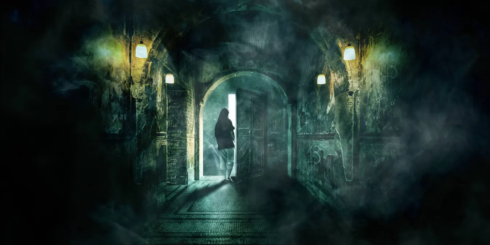
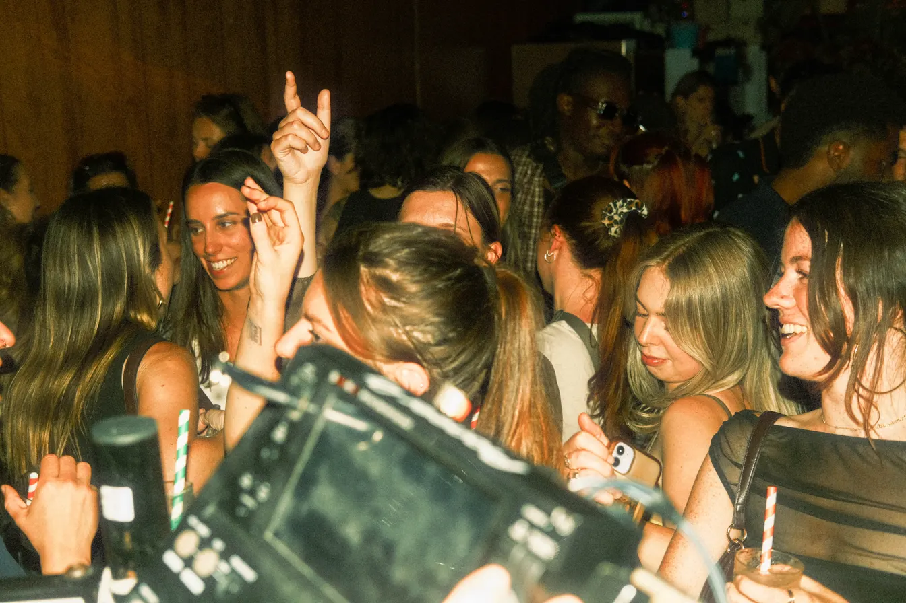

Your big coat is ready for a cultural renaissance. You’re mostly ready for chips.

# The Tip
## Dojo’s London weekend, 16–18 October 2026

You’ve reached the bit of October when putting on a jumper feels like having a personality. Fortunately, London has better material. The film festival reaches its final weekend, while your alternatives include anti-fascist photography, Brazilian music, and chocolate with considerably better provenance than your last situationship. You can get frightened in Battersea, dance in Dalston, or spend absolutely nothing on admission. Put the sofa relationship on hold. It’s getting clingy, and frankly, you deserve other furniture. ([whatson.bfi.org.uk](https://whatson.bfi.org.uk/lff/online/default.asp?BOparam%3A%3AWScontent%3A%3AloadArticle%3A%3Apermalink=about-the-festival&utm_source=openai))

## Some events for doing

### 1. Solidarity on the Streets, Bethnal Green

Give your scrolling thumb the afternoon off. Four Corners’ pop-up exhibition brings together photographs, archive film, and new local shorts tracing East End resistance to racism. Substantial, free, and worth your actual attention.

[Put your outrage in walking shoes →](https://www.fourcornersfilm.co.uk/whats-on/solidarity-on-the-streets)

**Friday 16 and Saturday 17, 11am–6pm.** Four Corners, 121 Roman Road, E2 0QN. Free exhibition entry. Closed Sunday. ([fourcornersfilm.co.uk](https://www.fourcornersfilm.co.uk/whats-on/solidarity-on-the-streets))

### 2. Black Zine Fair, Brixton

Your algorithm has had enough editorial control. Browse Black independent publishing at Brixton Library, with stalls including Sweet-Thang zine, Art As Activism, and Stefan Zinemaker. A much better shopping expedition than another emergency scented candle.

[Acquire a personality in stapled form →](https://www.lambeth.gov.uk/events/black-zine-fair)

**Saturday 17, from noon.** Brixton Tate Library, Brixton Oval, SW2 1JQ. Free, with registration linked from the council’s page. ([lambeth.gov.uk](https://www.lambeth.gov.uk/events/black-zine-fair?utm_source=openai))

### 3. Room 13, Battersea

You could confront your demons, or outsource the job to immersive theatre. This 35-minute paranormal investigation mixes fictional folklore with BAC’s history. A properly seasonal punt, provided darkness, jump scares, and theatrical smoke are your thing.

[Open the door marked “absolutely fucking not” →](https://bac.org.uk/whats-on/room-13/)

**Friday 16–Sunday 18, timed slots.** Battersea Arts Centre, Lavender Hill. Standard £20, peak £24.50, plus £2 per order. Pay What You Can is also advertised, with £16 recommended. Ages 16+, with under-18s accompanied. Arrive 20 minutes early. ([bac.org.uk](https://bac.org.uk/whats-on/room-13/?utm_source=openai))

### 4. In Praise of Stillness, South Bank

An hour devoted to slow cinema sounds suspiciously like permission to stop achieving things. Helen de Witt’s illustrated talk explores filmmakers including Kelly Reichardt and Béla Tarr. Your Sunday brain deserves this rather than another productivity podcast.

[Let the plot take its bloody time →](https://whatson.bfi.org.uk/lff/Online/default.asp?BOparam%3A%3AWScontent%3A%3AloadArticle%3A%3Apermalink=in-praise-of-stillness-lff26)

**Sunday 18, noon–1pm.** BFI Southbank, Belvedere Road. Free, ages 15+. Booking required, but tickets don’t guarantee entry. Doors and the standby queue open 15 minutes beforehand. ([southbank.london](https://southbank.london/whats-on/lff-for-free))

## Stuff to eat and drink

### 5. London Craft Chocolate Fair, Clerkenwell

Finally, a tasting vocabulary you’ll willingly revise. Cocoa Runners brings bean-to-bar makers including Pump Street, Chocolarder, and Bare Bones to Fidelio Café. Go for samples and discoveries, not the pretence that you’re buying everything as presents.

[Give your emergency chocolate higher qualifications →](https://cocoarunners.com/event/craft-chocolate-fair-entry-time-slots/)

**Saturday 17, 10am–6pm, and Sunday 18, 10am–5pm.** Fidelio Café, 91–95 Clerkenwell Road, EC1R 5BX. £5 timed entry. Talks cost extra. Walk-up queuing remains possible if advance slots fill. ([cocoarunners.com](https://cocoarunners.com/event/craft-chocolate-fair-entry-time-slots/))

### 6. Maltby Street Market, Bermondsey

If your lunch plans require a committee, take the committee to the railway arches. Maltby’s independent traders cover raclette, bavette steak, and tacos. A dependable weekend classic for incompatible appetites, with considerably less diplomacy than sharing small plates.

[Conduct negotiations over melted cheese →](https://maltbystmarket.squarespace.com/)

**Saturday 17, 10am–5pm, and Sunday 18, 11am–4pm.** Ropewalk, Maltby Street, SE1 3PA. Walk-up market. Food is priced individually by traders, with no single published meal price. ([maltbystmarket.squarespace.com](https://maltbystmarket.squarespace.com/?utm_source=openai))

## Some noise for making

### 7. Vincent Burke & Sascha Osborn, Herne Hill

Your Friday pub visit can have a soundtrack better than someone’s divorce. Vincent Burke’s melodic songwriting meets Sascha Osborn’s folk, jazz, and retro-soul at the Half Moon. Pick this for intimacy rather than industrial-strength spectacle.

[Put something tuneful beside your pint →](https://www.hernehillfestival.org/events/2026-10-16-evening)

**Friday 16, 8–10pm.** The Half Moon, 10 Half Moon Lane, SE24 9HU. £12.75, or £10.75 concessions, including booking fees. Book through the festival. ([hernehillfestival.org](https://www.hernehillfestival.org/events/2026-10-16-evening))

### 8. London Choro Festival’s free rodas, Dalston

You don’t need a music degree, or even a convincing nod. These Brazilian musical gatherings welcome listeners alongside players, with a free 5pm session each day. An excellent introduction before committing to the separately ticketed evening concerts.

[Upgrade your jam beyond strawberry →](https://londonchorofestival.org/)

**Friday 16–Sunday 18, 5pm.** Copper Cats, 574–576 Kingsland Road, Dalston. The rodas are listed as free events without an advance-ticket link. Evening concerts are separate. ([londonchorofestival.org](https://londonchorofestival.org/))

### 9. 3 Evenings: Saturday, Wapping

Give your evening a useful dose of “what the hell was that?”. Holly Blakey and Tai Shani collaborate, Team Rolfes performs, and interactive installations fill the programme. The adventurous pick for anyone bored by politely looking at things.

[Put your night through the experimental wash →](https://www.somersethouse.org.uk/whats-on/3-evenings-saturday)

**Saturday 17, 6.30–10.30pm.** Wapping Hydraulic Power Station, 25 Wapping Wall, E1W 3SF, **not Somerset House**. £25, or £20 concessions. Ages 18+. Saturday booking is listed separately from the sold-out weekend pass. ([somersethouse.org.uk](https://www.somersethouse.org.uk/whats-on/3-evenings-saturday?utm_source=openai))

### 10. Club Mix, Dalston

Your taste can be impeccable tomorrow. Tonight, Ridley Road’s DJs promise Prince, Girls Aloud, Missy Elliott, and enough familiar choruses to expose your secret repertoire. The low-stakes dancing option, especially if you beat the cover charge.

[Let your hips file the minority report →](https://www.ridleyroadmarketbar.com/event-details/club-mix-2026-10-17-18-00)

**Saturday 17, 6pm–3am Sunday.** Ridley Road Market Bar, 49 Ridley Road, E8 2NP. Free before 10pm, £6 afterwards. Walk-ins welcome subject to capacity. Two ginger mojitos are advertised at £13. ([ridleyroadmarketbar.com](https://www.ridleyroadmarketbar.com/event-details/club-mix-2026-10-17-18-00))

---

## Minted to Skinted
### Two Saturdays, neither spent refreshing your bank balance

You don’t need to turn your weekend into a procurement exercise. Nevertheless, knowing the admission bill before leaving home is oddly erotic. Here are two versions of Saturday 17 October, depending on whether payday is a fond memory or a distant rumour.

### Minted-ish: chocolate, then something strange

Start with a **£5 afternoon slot at the Chocolate Fair**, then leave yourself a generous gap before **3 Evenings in Wapping at 6.30pm, £25**. Your advertised admission subtotal is **£30 per person**, excluding any checkout extras, travel, food, and the chocolate you solemnly promised not to buy. Book the evening first, then build the afternoon around it. ([cocoarunners.com](https://cocoarunners.com/event/craft-chocolate-fair-entry-time-slots/))

The appeal isn’t luxury. You get two very different forms of curiosity, one involving your mouth and the other potentially requiring a long conversation afterwards. That’s a date structure, incidentally, not a guarantee of shagging.

### Skinted: an east London day with no admission bill

Make **Four Corners** your early-afternoon stop, then head to **Copper Cats for the free 5pm roda**. If you still fancy dancing, move on to **Ridley Road before 10pm**, while entry is free. That makes the advertised admission total **£0**, provided the bar has room. Travel, refreshments, and any purchases remain yours to budget. ([fourcornersfilm.co.uk](https://www.fourcornersfilm.co.uk/whats-on/solidarity-on-the-streets))

Don’t treat “free” as an instruction to consume everything and sprint onward. Pick a photograph to sit with. Listen to a whole piece. Ask your companion something that isn’t “what do you do?”. You’re having a Saturday, not completing a loyalty card.

**The verdict:** spend on the unusual thing you genuinely want to see. Save on the bits you were only booking to feel organised. Your calendar is not your personality, despite what the jumper says.

---

**Before you put your shoes on:** listings and advertised prices were checked on 14 October. Live ticket allocations could not be confirmed for Room 13, the BFI talk, 3 Evenings, the Half Moon gig, or the Zine Fair’s registration. Follow the official links before travelling, and don’t mistake a booking button for a reserved place.
