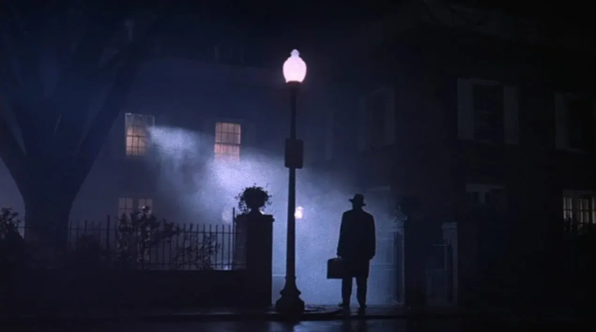

*the clocks go back on sunday, sadly not far enough to un-send that text.*

# the tip

## london, friday 23–sunday 25 october 2026

the clocks go back at 2am on sunday, giving you an extra hour you will absolutely spend asleep. half term is lurking, halloween is a week away, and the weather has gone full damp wool. luckily, london has a proper weekend lined up: ibsen in dalston, a silent horror film with a live band in forest hill, free art in peckham, and a pub exorcism that can cost you nothing. put your shoes on. it's the least you can do.

## some events for doing

### 1. the master builder, dalston

ibsen's architect dreads being overtaken by someone younger, which makes this a performance review with better lighting. greg hicks leads david edgar's version in the arcola's studio 1, running two hours twenty with interval. grown-up drama for anyone whose attention span survived the week.

[bag a seat at someone else's midlife crisis](https://www.arcolatheatre.com/event/the-master-builder/)

**when:** friday 23 october, 7pm, and saturday 24 october, 2.30pm and 7pm. no sunday performance · **venue:** arcola theatre, studio 1, 24 ashwin street, dalston, e8 3dl · **cost:** £12 to £39, with concessions available · **booking:** book online. the listings carry "last few" tags, so don't dawdle. age guidance is 13+.

### 2. peckham platform's new space, peckham

peckham platform is throwing a housewarming in the bussey building, and for once you're invited. expect pop-up stalls, courtyard music, and old peckham footage from 1970 to 2011. free, friendly, and nosy in the best way.

[nose around the new gaff](https://www.peckhamplatform.com/all-events/where-we-are-now-welcome-to-our-new-space/)

**when:** saturday 24 october, 1–5pm, with a panel talk from 3–4pm · **venue:** peckham platform, unit ag1, bussey building, 133 copeland road, peckham, se15 3sn · **cost:** free · **booking:** the listing only asks for tickets for the panel talk, which are [free but limited](https://www.eventbrite.com/e/who-i-am-now-panel-discussion-tickets-2002513629171).

### 3. faust with immersive live score, forest hill

murnau's 1926 faust gets a live score on trumpet, violin, guitar, organ, electric viola, and vocal effects, with foley sound effects on top. it's a proper halloween treat in the horniman's pavilion. spooky, strange, and cheaper than most souls.

[sell your soul for fifteen quid](https://www.horniman.ac.uk/event/immersive-live-score/)

**when:** sunday 25 october, 5–7pm · **venue:** the pavilion, horniman museum and gardens, 100 london road, forest hill, se23 3pq. enter by the london road gate, then it's a walk uphill · **cost:** £15 adult · **booking:** tickets through the horniman's event page. seating is provided and the venue is wheelchair accessible. no sold-out label showed when checked.

### 4. the exorcist, deptford

deptford cinema's pay-what-you-can screening takes over the brookmill, a corner pub, for william friedkin's 1973 horror. pay nothing, pay £4.50, or pay in therapy later. cheap, communal, and unwise before bed, but fuck it.

[pay what you can to get properly possessed](https://www.deptfordcinema.org/new-events/brookmill/exorcist)

**when:** sunday 25 october, 7.30pm, finishing about 10pm · **venue:** the brookmill, 65 cranbrook road, deptford, se8 4ej · **cost:** pay what you can. online options are £0, £1.50, £3, or £4.50, with £4.50 suggested, or pay any amount at the door · **booking:** tickets through ticketsource from the deptford cinema page. 18 certificate. the page doesn't say how many seats remain.

## some noise after dark

### 5. the lure + phantom of the paradise, dalston

rio's late double bill pairs the lure, a polish fairy tale about mermaid sisters in a nightclub act, with phantom of the paradise, whose plot turns on a stolen rock-opera faust. it starts at 11.30pm and runs 210 minutes. unhinged in exactly the right way.

[stay up for mermaids and terrible decisions](https://riocinema.org.uk/Rio.dll/WhatsOn?f=2403221)

**when:** friday 23 october, 11.30pm, with a short break between the films · **venue:** rio cinema, 107 kingsland high street, dalston, e8 2pb · **cost:** the rio lists friday to sunday tickets at £15.50, or £12.50 for concessions and members, but special events can price differently, so check the film page · **booking:** the book now button was live with no sold-out marker. 18 certificate. the lure is in polish with english subtitles.

### 6. brooklyn to brixton all-dayer, brixton

seven quid buys you seven bands. four brooklyn acts, including kenny young and the eggplants, cross the atlantic to join three south london groups in support of doc'n roll. loud, cheap, and 18+, which is exactly how saturdays should be.

[trade seven quid for seven bands and a ringing in your ears](https://www.windmillbrixton.co.uk/events/2026-10-24-brooklyn-to-brixton-all-dayer-the-windmill)

**when:** saturday 24 october, from 4.30pm · **venue:** the windmill, 22 blenheim gardens, brixton, sw2 5bz · **cost:** £7, plus a service charge at checkout · **booking:** e-tickets through the windmill's event page. 18+. the page doesn't state remaining availability.

### 7. carl stone + excel dj + silvia kastel, dalston

carl stone, a pioneer of live computer music, plays his first london show since his 70th-birthday residency here in 2023. marin naruse, silvia kastel, and excel dj complete the bill. brainy, weird, and a bloody good use of a sunday.

[let a computer ruin your sunday, nicely](https://www.cafeoto.co.uk/events/carl-stone-excel-dj-silvia-kastel-dj/)

**when:** sunday 25 october, 7.30pm · **venue:** cafe oto, 18–22 ashwin street, dalston, e8 3dl · **cost:** £17, or £15 in advance, or £10 for members · **booking:** book through cafe oto's event page. no sold-out notice showed when checked.

## stuff to eat and drink

### 8. bar buah at the white horse, peckham

a pub serving butifarra sausage, salt cod fritters, and acorn-fed ibérico pork isn't messing about. mallorquín chef elies salvà ruiz de villegas runs bar buah at the white horse, with sunday paella and churrimisú, which is churros meeting tiramisu.

[order the churrimisú before you talk yourself out of it](http://whitehorsepeckham.co.uk/bar-buah/)

**when:** food is friday 23 october, 6–9pm, saturday 24 october, 12–9pm, and sunday 25 october, 12–5pm · **venue:** the white horse, 20–22 peckham rye, peckham, se15 4jr · **cost:** the page doesn't publish menu prices · **booking:** walk-ins are always accommodated. booked tables need a £25 card authentication, with free changes up to 48 hours ahead and no same-day bookings. over-21s only from 8.30pm at weekends.

### 9. yagi izakaya at the kernel, bermondsey

the kernel's spa road taproom has yagi izakaya running a japanese kitchen residency, extended for all of 2026. gyoza, udon, and karaage are the headline acts. a small bermondsey indulgence with large dumpling energy.

[pair your pint with something fried and unapologetic](https://www.thekernelbrewery.com/tap.php)

**when:** taproom hours are friday 23 october, 12–10pm, saturday 24 october, 11am–9pm, and sunday 25 october, 12–8pm. weekend kitchen hours aren't published · **venue:** the kernel spa road taproom, bermondsey, se16 · **cost:** menu prices aren't listed on the site · **booking:** the site takes bookings for groups of four or more only, and saturday bookings are for large groups of 20 to 30.

### 10. brockley market, brockley

brunch doesn't have to cost a mortgage. brockley market fills the lewisham college car park with street food every saturday from 10am to 2pm, and it costs nothing to turn up. eat first, tut at the prices later, then pretend you're a regular.

[eat breakfast in a car park like a grown-up](https://www.brockleymarket.com/)

**when:** saturday 24 october, 10am–2pm · **venue:** lewisham college car park, lewisham way, brockley, se4 1ut · **cost:** free to enter. food and drink are priced by traders · **booking:** none. walk up. the site doesn't publish a trader list for this date.

## some classics

### 11. god's own junkyard, walthamstow

walthamstow's neon salvage yard holds chris bracey's collection, including signs from 1960s soho sex clubs, film work, and commissions. you get all the glow without the stricter dress code. free, filthy in heritage, and annoyingly photogenic.

[get lit, legally](https://www.godsownjunkyard.co.uk/)

**when:** friday 23 october, 11am–10pm, saturday 24 october, 11am–2pm because of a private event, and sunday 25 october, 11am–6pm · **venue:** god's own junkyard, unit 12, ravenswood industrial estate, shernhall street, walthamstow, e17 9hq · **cost:** free · **booking:** none listed. phone cameras are allowed for personal use but dslrs aren't. after 6pm, walk in through the estate's pedestrian gates on shernhall street or summit road.

### 12. columbia road flower market, bethnal green

the clocks go back, so 8am will feel like 9am and you have no excuse. the market runs until about 3pm, but go early, before it becomes a polite scrum of people carrying ferns. classic for a reason, and free to browse, so the damage is whatever shit you end up buying.

[buy flowers and pretend you own a vase](https://www.columbiaroad.info/)

**when:** sunday 25 october, from 8am until about 3pm · **venue:** columbia road, bethnal green, e2 7rg · **cost:** free to wander, with flowers priced by the stallholders · **booking:** none. walk up.

---

## minted to skinted

### two ways to spend the same weekend

knowing the damage before you leave the house is oddly erotic. so here are two versions of the weekend, one for the recently paid and one for everybody else.

### minted-ish: three tickets and a smug face

start saturday at [dulwich picture gallery](https://www.dulwichpicturegallery.org.uk/whats-on/hokusai-thirty-six-views-of-mt-fuji-from-the-iuchi-collection/), where hokusai's thirty-six views of mount fuji is billed as the first time the full series has been shown in the uk. adult tickets start from £21.50, and entry is by timed slot, so check saturday availability before you set off. that evening, head to *the master builder* at the arcola, where tickets run from £12 to £39. then finish with *faust* at the horniman on sunday for £15.

advertised admission comes to between £48.50 and £75.50, depending on how close to the stage your arse wants to be. that's before travel, food, and the second drink you'll definitely say yes to. it's a decent shape for a weekend: one thing for your eyes, one for your brain, and one for your soul, which you're apparently selling.

### skinted: seven quid, seven bands

saturday begins with brockley market (free to enter), moves on to peckham platform's housewarming (free), and ends at the windmill's all-dayer from 4.30pm for £7. sunday means columbia road's flower market (free to wander), then the exorcist at the brookmill, pay what you can, from £0.

that's £7 at minimum, or £11.50 if you pay the suggested £4.50 for the film. it includes seven bands, a few hundred flowers, and one demon. you'll still need to eat and get home, so budget for chips, which are the true currency of a skint weekend.

**the verdict:** spend on the one thing you'd regret missing. save on everything else. for most people that's one ticket, and for the rest of us it's the second drink.

## dating 101: the clocks-go-back edition

### three dates, ranked by how much you can afford to lose

the clocks go back at 2am on sunday, which gives you an extra hour and a flimsy excuse for one more drink. spend it on someone worth the sixty minutes. here are three dates from this week's picks, ranked by risk.

### low risk: the housewarming

peckham platform's afternoon is free, informal, and packed with things to point at, so awkward silences have nowhere to live. follow it with food at the white horse, where bar buah serves from 12pm to 9pm on saturday. book ahead if you want certainty, with free changes up to 48 hours before.

### medium risk: the pub exorcism

the exorcist at the brookmill is pay what you can, so nobody can accuse you of being cheap, only of questionable taste. it's an 18 certificate, it starts at 7.30pm on sunday, and you'll learn a great deal about a person by whether they grip your arm or the armrest.

### high risk: the ibsen

*the master builder* runs two hours twenty with an interval, and it's about a man terrified of being replaced by someone younger. that's not a first-date theme. save it for date four, when you can bear to hear what they thought of it.

### the extra hour

if it's going well, say so out loud before the clocks do their trick. if it isn't, you've gained a spare hour to go home and rehearse a dignified text.

---

**before you put your shoes on:** listings and advertised prices were checked on 21 october. live availability couldn't be confirmed for the arcola ("last few" tags), the windmill, cafe oto, the rio, the horniman, or the brookmill, and dulwich's saturday slots weren't checked. brockley's hours come from its regular saturday schedule, the kernel's kitchen hours aren't published, and god's own junkyard closes at 2pm on saturday. follow the official links before you travel, and don't mistake a book now button for a seat.
