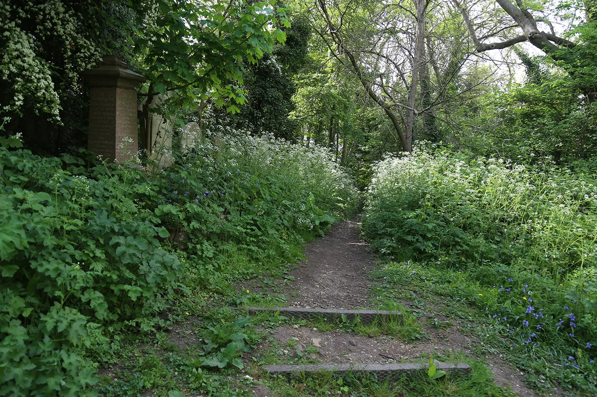
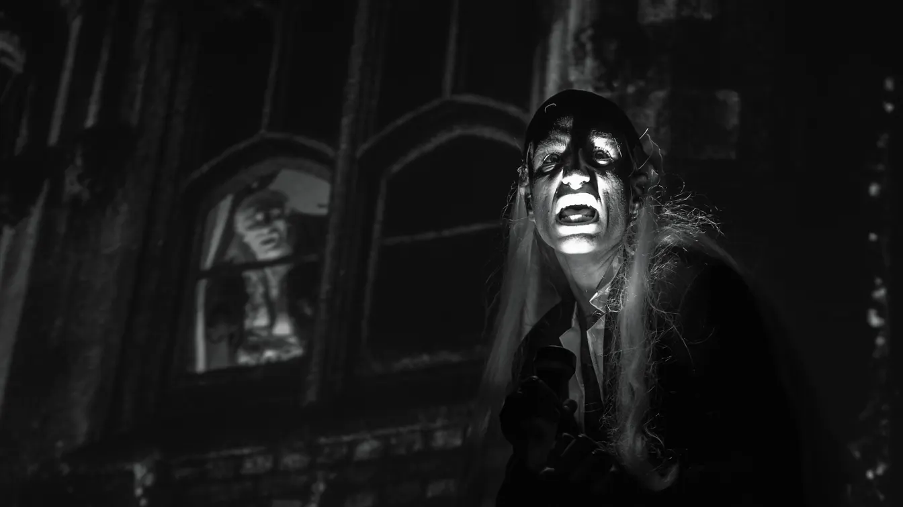

*the dead are out this weekend, and frankly most of them are better dressed than you.*

# the tip

## london, friday 30 october–sunday 1 november 2026

halloween lands on a saturday, which removes your last excuse for staying in. the clocks went back last weekend, so it's dark by teatime and every pub has a pumpkin wearing a hat. this weekend brings hellish art in kennington, fireworks in a velodrome, a midnight rocky horror, and a graveyard service for people who prefer their spooks sincere. costumes are optional. trousers, ideally, are not.

## some events for doing

### 1. paloma contreras lomas: disco inferno, kennington

paloma contreras lomas's first european solo show borrows from dante's inferno to pick at mexican violence, with room-scale murals, soft sculptures, ceramics, and a film with a zutzut soundtrack. grim, strange, and free, which is hell's only decent price.

[descend into hell, no ticket required](https://www.gasworks.org.uk/exhibitions/paloma-contreras-lomas-exhibition/)

**when:** friday 30 october, saturday 31 october, and sunday 1 november, 12–6pm. the show runs wednesday to sunday until 13 december · **venue:** gasworks, 155 vauxhall street, kennington, se11 5rh · **cost:** free · **booking:** none listed. no events are listed for the weekend, so it's just you and the walls.

### 2. dog mom, elephant & castle

a newly divorced woman swears she isn't a dog person, until a scruffy stray refuses to leave her doorstep. tate elizabeth hanyok's comedy has death and infertility in the small print, so pack tissues and a sense of humour.

[adopt a stray with your friday night](https://southwarkplayhouse.co.uk/productions/dog-mom/)

**when:** friday 30 october, 7.30pm, and saturday 31 october, 3pm and 7.30pm. no sunday performance is listed. it runs about 1 hour 50 including an interval · **venue:** southwark playhouse borough, 77–85 newington causeway, elephant & castle, se1 6bd · **cost:** from £22, or from £18 for concessions, with no booking fee · **booking:** book online. the page recommends ages 14+ and warns of strong language, sexual innuendo, flashing lights, and a quiet gunshot effect. live availability wasn't visible when checked.

### 3. halloween fireworks, herne hill

a bonfire at 6pm, fire eaters, a fancy dress competition, and fireworks at 7pm, all inside a cycling velodrome. wrap up warm, eat from the stalls, and make a loud noise somewhere other than your flat.

[get your bang on, advance tickets only](https://fhhv.cc/pages/halloween-fireworks-1)

**when:** saturday 31 october. gates 5pm, fancy dress 5.45pm, bonfire 6pm, fireworks 7pm, led dance show 7.20pm, closing 9.30pm · **venue:** herne hill velodrome, burbage road, herne hill, se24. it's a short walk from herne hill, north dulwich, and west dulwich stations, and there's no parking on site · **cost:** adults £13 plus a £1 booking fee, ages 12–16 £8 plus 75p, and under-12s £1 plus 50p when accompanied by an adult · **booking:** tickets are sold in advance only. no alcohol, glass, or outside food. no sold-out notice showed when checked.

### 4. all souls service, nunhead cemetery

the friends of nunhead cemetery hold their annual all souls service on sunday at 2pm, an all-faiths 45 minutes remembering everyone buried there. it's quiet, sincere, and the one thing this weekend where nobody will shout trick or treat.

[say hello to the dead, politely](https://nunheadcemetery.org.uk/)

**when:** sunday 1 november, 2pm, lasting about 45 minutes. meet at the chapel. the cemetery is open daily, 8.30am–5pm on friday and saturday and 8.30am–4pm on sunday · **venue:** nunhead cemetery, linden grove entrance, nunhead, se15 3lp. it's under a ten-minute walk from nunhead station · **cost:** the page doesn't state a cost · **booking:** none mentioned. the friends' own page is the only source for the service, so check it before you go.

## some noise after dark

### 5. rob luft quartet, dalston

guitarist rob luft, instrumentalist of the year at the 2025 parliamentary jazz awards, plays two sets with joe wright, tom mccredie, and corrie dick. seating is mixed with standing, so wear shoes you trust. a grown-up friday for £20.

[book a spot and nod knowingly](https://www.vortexjazz.co.uk/event/rob-luft-quartet-2/)

**when:** friday 30 october, doors 7.45pm, music 8.30pm, in two sets · **venue:** vortex jazz club, 11 gillett square, dalston, n16 8az · **cost:** £20 standard, £18 for vortex members, and £16 for students and uc beneficiaries · **booking:** online through universe. seats are only guaranteed for members or anyone who can't stand and tells the venue in advance. no sold-out notice showed when checked.

### 6. halloween taproom party, hackney wick

crate's taproom and studio becomes a warehouse party, with lo-low and corcra playing disco, deep house, and techno through a custom core sound system. costumes may earn you a drink token. free, loud, and a bloody good excuse to leave the house.

[grab a free ticket before the ghouls do](https://ra.co/events/2563671)

**when:** saturday 31 october, from 8pm. the finish time isn't listed · **venue:** crate brewery taproom and studio, queen's yard, white post lane, hackney wick, e9 5en · **cost:** free · **booking:** the crate listing points to free tickets on resident advisor. age rules and remaining availability weren't listed.

### 7. halloween bang, peckham

dj dan melrose plays party classics from rihanna, abba, and ray parker jr. at john the unicorn's halloween party, with tickets from £5.50. cheesy, sweaty, and best in a wig you can afford to lose.

[spend £5.50 on a cheesy sweat-fest](https://www.designmynight.com/london/pubs/peckham/john-the-unicorn/halloween-bang)

**when:** saturday 31 october. the listing says 8pm–3am, with early tickets before 9pm and late tickets from 9pm · **venue:** john the unicorn, 157–159 rye lane, peckham, se15 4tl · **cost:** £5.50 for early entry and £11 for late entry · **booking:** book online through designmynight. 18+ and id may be required. tickets can't be exchanged or refunded, and sold-out status isn't shown.

### 8. the rocky horror picture show with shadow cast, dalston

queer horror nights brings a live cabaret shadow cast to the rio, performing in front of the 1975 film. the costume competition starts at 11.30pm, the film at midnight, and a party bag comes with your ticket. fishnets optional, enthusiasm mandatory, bedtime cancelled.

[do the time warp again, with feeling](https://riocinema.org.uk/Rio.dll/WhatsOn?f=1742916)

**when:** saturday 31 october. pre-drinks from 10.30pm, costume competition and welcome at 11.30pm, film from midnight, and close at 2am · **venue:** rio cinema, 107 kingsland high street, dalston, e8 2pb · **cost:** the listing doesn't state a price, so check at checkout. admission includes a party bag · **booking:** the book now button was live with no sold-out marker. 18+ only, and the organisers ask you not to bring extra props to throw.

### 9. fred frith, dalston

fred frith of henry cow and art bears fame plays a trio with tim hodgkinson and liz allbee, then a duo with verena marisa. night one of two. proper avant-garde from a guitarist who has worked with john zorn and derek bailey.

[get properly weird with a guitar legend](https://www.cafeoto.co.uk/events/fred-frith-2026/)

**when:** sunday 1 november, 7.30pm. the residency continues on monday 2 november · **venue:** cafe oto, 18–22 ashwin street, dalston, e8 3dl · **cost:** £22 on the door, £20 in advance, or £15 for members. a two-night pass is £36 in advance or £26 for members · **booking:** book through cafe oto's event page. no sold-out notice showed when checked.

## stuff to eat and drink

### 10. the tacover, walthamstow

more than 15 traders are expected, each selling at least three tacos, with single tacos capped at £4. add margaritas, mariachi, roaming luchadores, and a hot taco challenge. entry is £12.10 to £19.80, the tacos are extra, and your dignity is optional.

[eat three tacos, then lie about it](https://www.designmynight.com/london/bars/walthamstow/signature-brew-blackhorse-road/the-tacover-taco-festival-halloween)

**when:** saturday 31 october, brunch 10.30am–3.45pm and evening 4.30–11pm, and sunday 1 november, early entry 11am–8pm with last entry at 2pm, and late entry 3–8pm · **venue:** signature brew blackhorse road, unit 15, uplands business park, blackhorse lane, walthamstow, e17 5qj · **cost:** adult tickets run from £12.10 to £19.80 depending on session and how early you book, with children from £2.20. tacos are capped at £4 each in single portions, though some special items cost more · **booking:** book online by session. saturday evening is strictly over-18, and sunday sessions don't include access to the brew hall. the page doesn't show whether any sessions are sold out.

### 11. donald's, hackney wick

cardiff's donald's opened its first site outside wales on wick lane, and it's weekends only. the pies are mince beef and cheddar, butter chicken curry, ratatouille and vegan feta, and bbq pulled pork. queues greeted opening weekend, so go early.

[get stuck into something hot and meaty](https://donaldspies.com/)

**when:** saturday 31 october and sunday 1 november. it's weekend-only, with one listing giving 10am–4pm. the shop's own site doesn't publish hours, so check before you go · **venue:** donald's, 455 wick lane, fish island, hackney wick, e3 2tb · **cost:** pies on donald's online shop are £5.95 each. in-shop prices weren't confirmed · **booking:** none found, so walk up and join the queue.

### 12. the old nun's head, nunhead

a pub on nunhead green with a pizza habit. slice circle serves new york-style 14-inch pies from noon to 9pm on friday and saturday, and the site lists a sunday roast. pair it with the all souls service for absolution.

[book a table and confess nothing](https://www.theoldnunshead.co.uk/slice-circle)

**when:** pizza is friday 30 october and saturday 31 october, 12–9pm. the pub is open friday and saturday 12pm–1am, and sunday 1 november 12–11pm, with a roast listed from 12pm until 6pm or sell-out · **venue:** the old nun's head, 15 nunhead green, nunhead, se15 3qq · **cost:** menu prices sit in pdfs linked from the site, so check before you go · **booking:** booking is advisable through the pub's bookings page. its events page also lists a halloween fright night on friday and sappho'ween on saturday, with no prices shown.

---

## minted to skinted

### two ways to spend the same halloween weekend

halloween is the one weekend when a pub will charge a fortune for a drink with a plastic spider in it and call it an experience. so here are two versions of the weekend, one for the recently paid and one for everybody who spent it all on a costume in september.

### minted-ish: four tickets and a smug face

friday is rob luft at the vortex, at £20 for standard entry. saturday's *dog mom* at southwark playhouse starts from £22, and if you take the 3pm matinee you can make the 7pm fireworks at herne hill velodrome, which cost £14 once the booking fee is added. sunday finishes with fred frith at cafe oto, at £20 in advance.

advertised admission comes to £76 for the four, before travel, tacos, or the sixth drink you'll swear is your last. that's jazz, theatre, a bonfire, and a guitar legend, which is a decent haul for the price of a mediocre hotel breakfast.

### skinted: one pie, one party, and a jazz jam

start friday at gasworks, where the hellish art is free. on saturday, find out whether a pie at donald's costs what its online shop charges, which is £5.95. that night, crate's halloween taproom party is free through resident advisor. sunday begins with nunhead cemetery's 2pm all souls service, which lists no charge, and ends with the vortex jam session at £6, or free if you're a member.

that's £6 in admission, or about £12 if the pie matches its online price. you'll still need to eat and get home, so budget for chips, which remain the true currency of a skint weekend.

**the verdict:** halloween doesn't cost £76. it costs whatever you let a pub talk you into. the free stuff is just as good, and nobody asks you to buy a cocktail named after a dead celebrity.

## the halloween rulebook

### six rules for people who left it too late

it's the last week of october, you own a bin bag and two safety pins, and you've decided that's a costume. fine. here are six rules to get you through the weekend with your dignity partly intact.

1. **check the age rule before the costume.** rocky horror at the rio and halloween bang at john the unicorn are 18+, and the tacover's saturday evening session is strictly over-18. dog mom recommends 14+ and warns of strong language, so leave the nephew at home.
2. **book the ones that insist.** the herne hill fireworks are advance tickets only, the tacover sells by session, and john the unicorn won't exchange or refund. spontaneity is lovely, but it has a booking fee.
3. **let the venue reward your laziness.** herne hill runs a fancy dress competition at 5.45pm, the rio starts its costume competition at 11.30pm, and crate says costumed guests may get a drink token. the bar for victory is low, and so, apparently, is yours.
4. **dress for the venue.** the velodrome is outdoors and bans alcohol, glass, and outside food, so wear a coat over the cape and eat from the stalls. leave the fangs at home for the cemetery.
5. **do the daylight stuff in daylight.** nunhead cemetery closes at 5pm on friday and saturday and 4pm on sunday, and gasworks shuts at 6pm. the clocks have already gone back, so the sun is a bastard with a very short shift.
6. **keep sunday gentle.** the all souls service lasts about 45 minutes, the old nun's head is open from noon until 11pm, and the vortex jam is £6, or free if you're a member. you've earned a roast, and your liver has earned a rest.

---

**before you put your shoes on:** listings and prices were checked on 28 october. live availability couldn't be confirmed for dog mom, the vortex, the rio, cafe oto, the tacover, or john the unicorn, and the rio's listing doesn't publish a price for rocky horror. crate's free tickets are listed through resident advisor, whose page wouldn't open, so check it before you go. donald's doesn't publish hours on its own site, the old nun's head's menu prices sit in linked pdfs, and the nunhead all souls service has no stated cost. herne hill's page gives no street address, so follow the official link. don't mistake a book now button for a seat.
