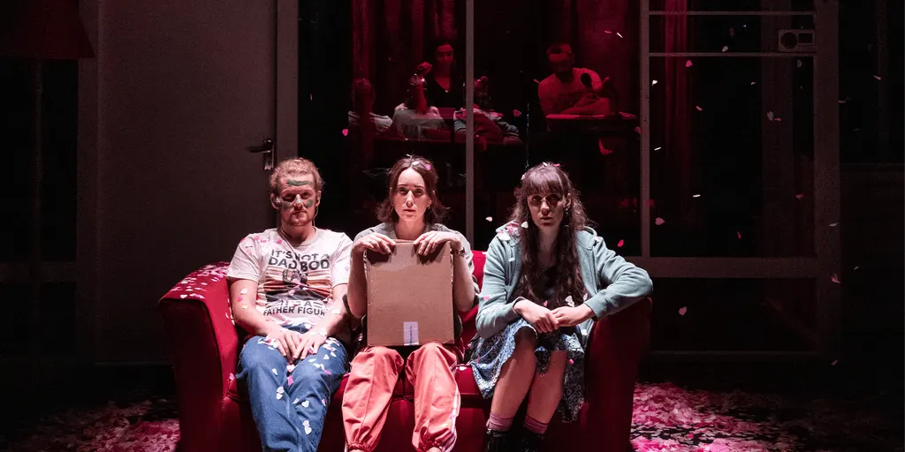
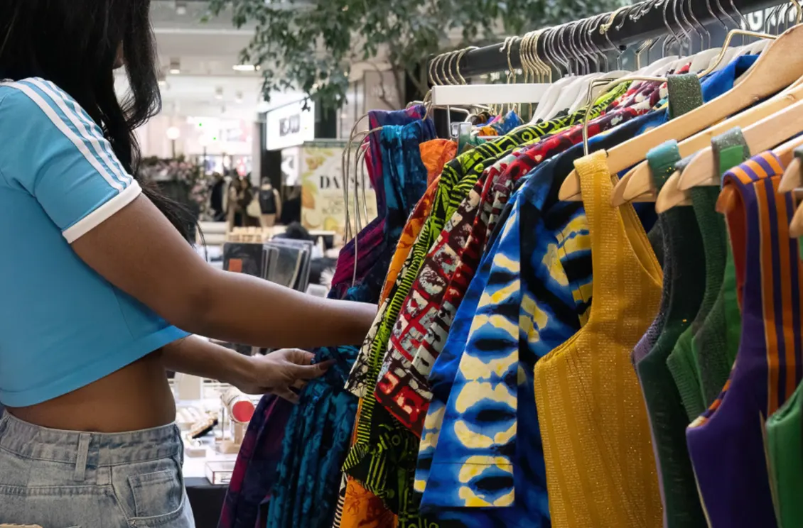
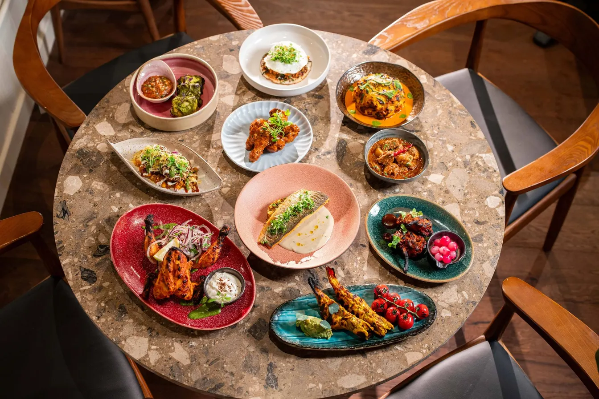

*bonfire night is over, so the only thing left to set alight is your bank balance.*

# the tip

## london, friday 6–sunday 8 november 2026

bonfire night was thursday, so the sky has stopped screaming and the dogs of london are finally out from under the bed. this weekend still has light to chase. diwali lands on sunday, blackheath lets off a proper bang on saturday, and remembrance sunday asks for two minutes of silence at 11am, which is more than most of us manage with a phone in reach. it's dark by teatime, so book something.

## some events for doing

### 1. good sex, battersea

dead centre and novelist emilie pine put two performers on stage who haven't read the script, with an intimacy director on hand. it runs 80 minutes with no interval, so pace yourself. awkward, funny, and probably too bloody relatable.

[book a night of questionable technique](https://bac.org.uk/whats-on/good-sex/)

**when:** friday 6 november, 7.30pm, running 80 minutes with no interval. the run is 4–6 november, so this is the last night · **venue:** battersea arts centre, grand hall, lavender hill, battersea, sw11 5tn · **cost:** pay what you can, with £25 recommended and grand hall tickets starting at £16, plus a £2 fee per order · **booking:** book online. ages 14+, with warnings for haze, simulated sex, strong language, partial nudity, and smoking on stage. it's a relaxed performance, and the page didn't show how many seats remain.

### 2. this must be the place, whitechapel

whitechapel gallery turns 125 with a painting show and sale in its old library assembly room. every work is for sale, so you can fall hopelessly for something you can't afford. free, but gone after sunday.

[window-shop for paintings you'll never own](https://www.whitechapelgallery.org/exhibitions/this-must-be-the-place/)

**when:** friday 6 november, saturday 7 november, and sunday 8 november, 11am–6pm. it closes on sunday 8 november · **venue:** whitechapel gallery, assembly room, 77–82 whitechapel high street, whitechapel, e1 7qx · **cost:** free · **booking:** none listed, so walk up. the show is closed on mondays, which makes sunday your last chance.

### 3. dovzhenko: first look, dalston

odesa, 1926, and a young oleksandr dovzhenko arrives to make his first film while the soviet system leans on him for propaganda instead. kostiantyn konovalov's drama runs 100 minutes in ukrainian with english subtitles, and the rio skips the ads. serious, and better than doomscrolling.

[watch a genius get leaned on by the state](https://riocinema.org.uk/Rio.dll/WhatsOn?f=3060694)

**when:** sunday 8 november, 5pm, running 100 minutes · **venue:** rio cinema, 107 kingsland high street, dalston, e8 2pb · **cost:** the listing doesn't state a price, so check at checkout · **booking:** book through the listing's eventbrite link. it's billed under women and the world. no q&a is listed, and the page doesn't show sold-out status.

### 4. all together now, greenwich

free diwali at the national maritime museum means bhangra, rangoli, lantern-making, a first-ever bazaar, and a puppet ramayana, ending in a lantern parade through greenwich park. colourful, warm, and free, which is the best sort of light show.

[follow the lanterns, not the algorithm](https://www.rmg.co.uk/diwali)

**when:** saturday 7 november, 10.30am–5pm. the diwali bazaar runs 11am–4pm in ocean court, and the lantern parade leaves at 5.15pm · **venue:** national maritime museum, romney road, greenwich, se10 9nf. the parade meets at ship in a bottle and goes through greenwich park · **cost:** free · **booking:** none required. you can book free museum tickets to guarantee entry or just turn up.

### 5. blackheath fireworks, blackheath

around 40,000 people are expected on blackheath common, with gates from 5pm and the display listed at about 8pm. last year's show sold out within weeks, so book ahead. loud, cold, and a decent excuse to stand too close to someone.

[stand on a freezing heath with 40,000 strangers](https://www.blackheathfireworks.com)

**when:** saturday 7 november. the event runs 5pm–10pm, and listings put the display at about 8pm · **venue:** blackheath common, blackheath, se3, with entrances at blackheath gate, lewisham gate, and greenwich gate · **cost:** from £16 for adults, £10 for ages 11–15, and £5 for under-10s. other listings show £17.60 for adults, so check the final price at checkout · **booking:** advance tickets through blackheathfireworks.com, with family tickets available. lewisham council's page shows no sold-out notice.

## some noise after dark

### 6. pop up & vibes, brixton

brixton house's foyer becomes an evening market of independent brands selling vintage, jewellery, crafts, and homeware, with drinks and live music from just vibez. the run ends on friday. free, and a handy way to buy presents early without hating yourself.

[shop small, drink slightly less small](https://brixtonhouse.co.uk/shows/pop-up-vibes/)

**when:** friday 6 november, 5pm for five hours, so until about 10pm. it's the last date of the run · **venue:** brixton house, 385 coldharbour lane, brixton, sw9 8gl · **cost:** free · **booking:** walk-ins are welcome, but booking is recommended through the event page. all ages.

### 7. dalston takeover, pitchfork festival

one wristband gets you into six dalston venues, including earth hall, cafe oto, and the shacklewell arms, for diiv, working men's club, psychedelic porn crumpets, and more than 20 other acts. £45 stings, but it's a festival for less than a decent dinner and a sulk.

[wristband up and wander dalston's sticky floors](https://pitchforkmusicfestival.co.uk/programme-tickets/)

**when:** saturday 7 november. wristband collection from 4pm at earth kitchen, 11–17 stoke newington road, n16 8bh. doors 4.30pm, and the last performance finishes by midnight · **venue:** earth hall, earth theatre, the shacklewell arms, the victoria, cafe oto, and st matthias church, all within walking distance in dalston · **cost:** around £42 to £47 depending on the seller. cafe oto lists £45, or £42.11 through dice · **booking:** buy through dice. the festival says unsold tickets will be available on the day. 18+ only, venues run one in, one out when full, and the page shows no sold-out marker.

### 8. thurston moore and mark wastell, dalston

thurston moore on electric guitar and mark wastell on drums return to the vortex after a december show described as deeply post-psychedelic. the 7.30pm set has sold out, so aim for the 10pm one. loud, strange, and monday will be a bastard.

[beat the sold-out sign to the late show](https://www.vortexjazz.co.uk/event/thurston-moore-and-mark-wastell/)

**when:** sunday 8 november. the 7.30pm show, with doors at 7pm, is sold out. the added show has doors at 9.30pm and music at 10pm, in one set · **venue:** vortex jazz club, 11 gillett square, dalston, n16 8az · **cost:** £20 standard, £17 for vortex members, and £15 for students and uc beneficiaries · **booking:** online through universe. the page doesn't say whether the 10pm show has sold out. seating is mixed with standing, and seats are only guaranteed for members or anyone who can't stand and tells the venue in advance.

## stuff to eat and drink

### 9. kokum diwali feast, east dulwich

kokum's diwali sharing feast runs until sunday, with pani puri, paneer tikka angara, butter chicken, dal makhani, and a shrikhand pudding. nani's nightcap, a boozy vanilla ice cream number, is also on. greedy, glorious, and you'll leave unbuttoned.

[book a table, then undo a button](https://www.kokumlondon.com/diwali-menu)

**when:** the feast runs 3–8 november, so friday 6 november, saturday 7 november, and sunday 8 november are all in. regular hours are friday 12.30–11pm, saturday 12–11pm, and sunday 12–10pm · **venue:** kokum, 58–60 east dulwich road, east dulwich, se22 9ax · **cost:** £45 per person, according to sheerluxe and secret london. kokum's own page doesn't list a price or say whether the nightcap is included · **booking:** diwali bookings are open through the restaurant's page. closed mondays, and the full menu sits in a pdf on the site.

### 10. the ivy house, nunhead

the ivy house calls itself london's first community-owned pub, and its sunday kitchen runs until 6pm. doolally tap play for free at 4pm, and there are nine craft beers and four cask lines. a roast with a soundtrack.

[pull up a chair in the neighbours' pub](https://www.ivyhousenunhead.com/whats-on)

**when:** sunday 8 november. the kitchen runs 12–6pm with roasts mentioned, doolally tap play at 4pm, and the pub is open 12–10.30pm. on friday and saturday it's open 12pm–midnight · **venue:** the ivy house, 40 stuart road, nunhead, se15 3be · **cost:** doolally tap is free. the page doesn't list roast prices · **booking:** the page links to a table-booking form for sunday.

## some classics

### 11. broadway market, hackney

produce, street food, locally designed clothes, and crafts line broadway market every saturday, with sunday hours too. go early, graze like a goat, and leave with a tote bag you didn't plan to fill.

[graze until your tote bag groans](https://hackney.gov.uk/broadway-market)

**when:** saturday 7 november, 9am–5pm, and sunday 8 november, 10am–5pm · **venue:** broadway market, london fields, hackney, e8 · **cost:** free to wander. food and goods are priced by traders · **booking:** none, so walk up. hackney council lists no notices for november.

### 12. manze's, peckham

pie, mash, liquor, and eels on peckham high street, which is the opposite of brunch. open until 3.45pm on saturday, with takeaway for 15 minutes after. heavy, hot, and gloriously unfashionable, which is exactly what november demands.

[get mashed before the shutters come down](https://www.manze.co.uk)

**when:** saturday 7 november, 10am–3.45pm, with takeaway for up to 15 minutes after closing. the opening-times page doesn't list peckham's sunday hours, so call before you go · **venue:** m. manze, 105 peckham high street, peckham, se15 5rs · **cost:** the site doesn't publish menu prices · **booking:** none, so walk up and queue. the official page gives 020 7277 6181 for sunday hours.

---

## minted to skinted

### two ways to spend the same weekend

bonfire night has left your bank account looking like the guy on top of the pile. so here are two versions of the weekend, one for the recently paid and one for everybody who bought a jumper they didn't need.

### minted-ish: a play, a festival, a feast, and a late guitar

friday is *good sex* at battersea arts centre, where the recommended price is £25 plus a £2 fee. saturday is the dalston takeover, which cafe oto lists at £45. sunday is kokum's diwali feast at a reported £45 a head, then thurston moore and mark wastell's late set at the vortex for £20.

that comes to £137 in advertised prices, before drinks, travel, or the nightcap you'll absolutely order. you get theatre, a mini festival, a feast, and a guitar legend, which is a better return than most pensions.

### skinted: lanterns, paintings, and a free band

friday begins at pop up & vibes in brixton house, which is free. saturday is the diwali festival at the national maritime museum, also free. sunday finishes at whitechapel gallery for the last day of the painting sale, then the ivy house in nunhead for doolally tap at 4pm, free again.

that's £0 in admission. if you can't resist theatre, *good sex* lists tickets from £16 plus the £2 fee, so £18 gets you into the grand hall. you'll still need to eat, and manze's doesn't publish prices, so bring optimism.

**the verdict:** the free weekend has a lantern parade, a painting sale, and a roast with a live band. the expensive one has a feast, a festival, and a very loud guitar. both end with you asleep on a night bus.

## one saturday, two kinds of light

### greenwich to blackheath, in six steps

saturday has a free festival and a ticketed fireworks display on the same side of the river. greenwich park sits next door to blackheath, and the museum's lantern parade goes through it. that's rare in london, where most days out involve a replacement bus and an argument.

1. **10.30am: start at the national maritime museum.** the festival is free, and the first performances start on the ocean map around 10.30am. no booking is needed, though you can book free museum tickets to guarantee entry.
2. **11am: browse the bazaar.** the first diwali bazaar runs 11am–4pm in ocean court, with stalls from south asian designers and local greenwich businesses. rangoli art starts at 11am too.
3. **11.30am onwards: make a lantern.** lotus lantern making runs 11.30am–4.30pm, and the parade invites you to bring what you've made. glue on your fingers is its own reward.
4. **5.15pm: join the lantern parade.** it leaves from ship in a bottle and takes 15 minutes through greenwich park.
5. **5.30pm: head for blackheath.** gates open at 5pm on the common, and the display is listed at about 8pm. you have time to eat something hot and find the right gate.
6. **about 8pm: look up.** stand close, say ooh, repeat.

the museum bit is free. the fireworks need an advance ticket, from £16 for adults, so book before saturday morning's smugness turns into saturday afternoon's panic.

## sunday, in order

### a timetable for people who can't choose

sunday has a national silence, a painting sale's last day, a feast, a roast, a free band, a ukrainian drama, and a guitar legend. you can't do it all, and you shouldn't try. here's the order if you want as much as possible without collapsing.

1. **11am: stop for two minutes.** the national two-minute silence is at 11am on remembrance sunday, and the cenotaph service on whitehall runs until about 11.25am, according to gov.uk.
2. **11.30am: whitechapel gallery's last day.** the painting sale closes on sunday and the show is closed on mondays, so don't leave it for the commute.
3. **12pm: lunch somewhere that cooks.** kokum is open 12–10pm with the diwali feast on its final day, and the ivy house kitchen runs 12–6pm for roasts.
4. **4pm: doolally tap at the ivy house.** free, and loud enough to make the roast go down.
5. **5pm: dovzhenko: first look at the rio.** you can't do both 4pm and 5pm, because you're not a time lord.
6. **10pm: thurston moore and mark wastell at the vortex.** doors are 9.30pm, and the 7.30pm show is already sold out.

pick two or three. any more and you're not having a weekend, you're doing an audit.

---

**before you put your shoes on:** listings and prices were checked on 4 november. live availability couldn't be confirmed for *good sex*, the rio, the dalston takeover, the vortex's 10pm show, or kokum, and thurston moore's 7.30pm show is already sold out. the rio's listing doesn't publish a price for dovzhenko. kokum's own page doesn't give its £45 price, which comes from sheerluxe and secret london listings. blackheath fireworks' ticket site wouldn't open when checked, so the prices come from lewisham council's page, and other listings show adults at £17.60. dalston takeover prices run from £42.11 to £47 depending on the seller. manze's doesn't publish menu prices or peckham's sunday hours. the museum's press release gives a 10am start for its diwali festival, while its own diwali page says 10.30am. the ivy house doesn't publish roast prices. don't mistake a book now button for a seat.
