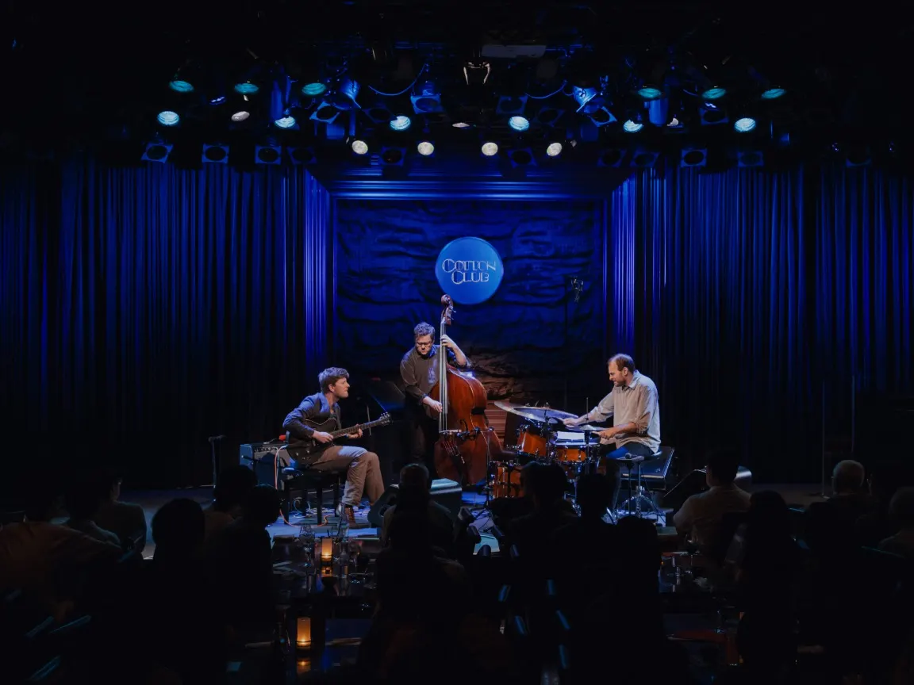
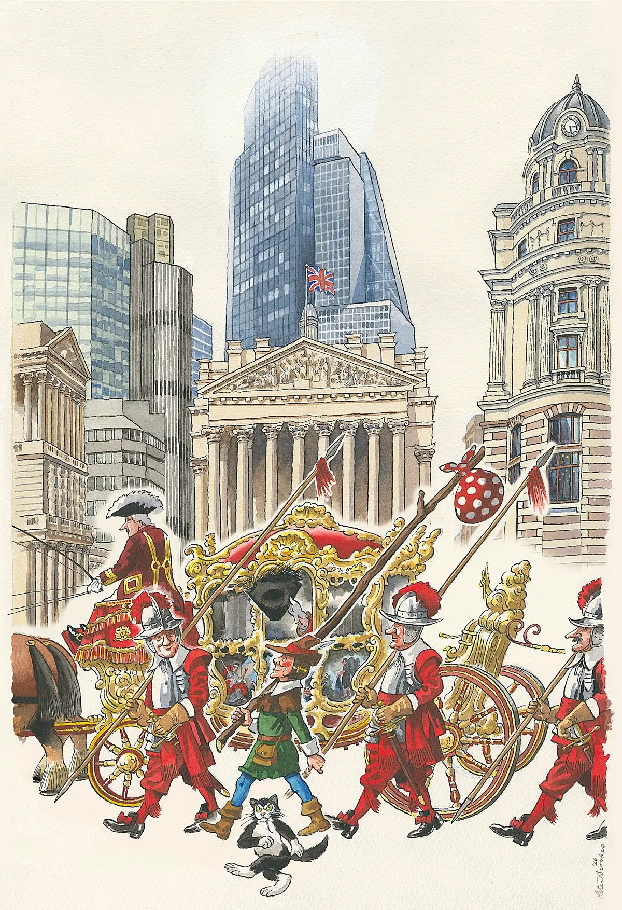

*it's friday the 13th, so if the date goes badly, blame the calendar and not your personality.*

# the tip

## london, friday 13–sunday 15 november 2026

it's friday the 13th, the sun clocks off before half four, and the clocks went back a few weeks ago without you ever really recovering. so lean in. the london jazz festival opens, the lord mayor's show rolls through the city on saturday, and east and south london are busy being cheaper and stranger. there are films, free gigs, spice bags, and a giant leaf pile. mind the ladders, and don't be a superstitious prick.

## some events for doing

### 1. screamstation fest, shoreditch

despite the name, screamstation isn't a slasher marathon. close-up cinema screens 17 films from 13 countries, with experimental work on friday the 13th and innovative shorts on saturday. arty, odd, and best chased with a stiff drink.

[book a seat for an arty kind of fright](https://www.closeupfilmcentre.com/film_programmes/2026/screamstation-fest)

**when:** friday 13 november, 7pm for the experimental film section, and saturday 14 november, 4pm for the innovative short film section. individual films run from 1 to 22 minutes · **venue:** close-up film centre, 97 sclater street, shoreditch, e1 6hr · **cost:** the page doesn't list prices, so check at checkout · **booking:** online through ticketsource, with a separate link for each section. the page shows no sold-out marker and gives no content warnings, though the films cover sexuality, power, ecology, and violence.

### 2. mubi fest, hackney

mubi's first london festival fills hackney picturehouse with *drive* at 15, *donnie darko* with a live podcast, and director q&as. a few events are free drop-ins. catnip for film nerds, so queue early and pretend you've seen everything.

[book a seat and pretend you've seen it all](https://mubifest.com/en/london)

**when:** friday 13 november to sunday 15 november. highlights are *drive* on friday at 6.45pm, *donnie darko* with a live podcast on friday at 9pm, *the handmaiden* on saturday at 2.15pm, *coward* with a q&a on saturday at 7.30pm, and *a long winter* with a q&a on sunday at 5.30pm. the brief encounters short film programme is marked free on saturday at noon · **venue:** hackney picturehouse, 270 mare street, hackney, e8 1he · **cost:** the festival page doesn't list ticket prices, so check at checkout · **booking:** most events book through dice, and unticketed drop-ins are marked on the page. the page shows no sold-out markers.

### 3. nero, elephant & castle

steven sater and duncan sheik, the *spring awakening* duo, give rome's most notorious emperor a new musical, with andrew barth feldman in the title role. it runs two and a half hours with an interval. bloody, ambitious, and from £20.

[book a seat before rome burns](https://southwarkplayhouse.co.uk/productions/nero/)

**when:** friday 13 november, 7pm, and saturday 14 november, 2.30pm and 7pm. no sunday performance is listed. it runs about 2 hours 30 including an interval, with no re-entry and no latecomers · **venue:** southwark playhouse elephant, 1 dante place, elephant & castle, se11 4rx · **cost:** from £20, with concessions from £16 and no booking fee · **booking:** online or by phone on 020 7407 0234. ages 15+, with warnings for strong language, blood, nudity, violence, smoke, haze, strobe, and gunshots. the page didn't show how many seats remain.

### 4. autograph, shoreditch

autograph's two free photography shows make a civilised friday afternoon. one pairs three feminist artists from the americas across 65 works, and the other traces how british colonial rule restricted gender expression and intimacy in india. serious, striking, and free.

[look at things that matter, for nothing](https://autograph.org.uk/exhibitions)

**when:** friday 13 november, 11am–6pm, and saturday 14 november, 12.30–6pm. the main page lists sunday as closed, and both shows run until 13 february 2027 · **venue:** autograph, rivington place, shoreditch, ec2a 3ba · **cost:** free · **booking:** none required, though you can prebook free timed tickets. the main page gives saturday opening as noon, so allow for a half-hour difference. *our bodies have been bridges* contains nudity.

## some noise after dark

### 5. king ayisoba, lewisham

king ayisoba plays the kologo, a two-stringed ghanaian instrument, over electronic beats and a gravelly voice, billed as traditional music dug up from the future. the early bird has gone, but it's still £12.50 or £15 before fees. loud, strange, and worth the trek.

[grab a ticket and let the future dig you up](https://foxfirkin.com/event/king-ayisoba-13th-november-2026/)

**when:** friday 13 november, 7–10pm. the page doesn't give separate doors and start times · **venue:** the fox and firkin, 316 lewisham high street, lewisham, se13 6jz · **cost:** £12.50 for first release or £15 general admission, plus a 10% booking fee. the £10 early bird has sold out · **booking:** online through the event page, or call the venue on 020 8690 0969. no age limit is stated, and a separate club night starts at 10pm.

### 6. ari hoenig trio, dalston

the london jazz festival gets going on friday, and the vortex joins in on saturday with drummer ari hoenig's trio. two shows, each one set, playing music from the album *enchanted*. tight, intimate, and ideal for pretending you understand time signatures.

[book a ticket and try not to tap along](https://www.vortexjazz.co.uk/event/ari-hoenig-trio-featuring-tom-ollendorff/)

**when:** saturday 14 november. the first show has doors at 6.30pm and music at 7pm, and the second has doors at 8.30pm and music at 9pm. each is one set · **venue:** vortex jazz club, 11 gillett square, dalston, n16 8az · **cost:** £23 standard, £20 for vortex members, and £19 for students and uc beneficiaries · **booking:** online through universe. your ticket only admits you to the show you book, so arrive for that door time. the page doesn't say whether either show has sold out.

### 7. soul focus, walthamstow

free entry, deep and soulful drum and bass from iplaynoise and bogart, and a walthamstow taproom that keeps going until 2am. it's friday the 13th, so you may as well sweat the bad luck out. cheap, loud, and probably too bassy for your fillings.

[stroll in for free and let the bass do the exorcism](https://www.exale.uk/events/soul-focus-5p4jd)

**when:** friday 13 november, 9pm–2am, so into saturday morning · **venue:** exale taproom, unit 2c, blackhorse lane, walthamstow, e17 5qj · **cost:** free · **booking:** none is mentioned. the listing doesn't state an age limit, and the site lists the kitchen's friday hours as 4–9pm.

## stuff to eat and drink

### 8. street and contemporary art fayre, lewisham

the fox & firkin's garden hosts street and contemporary artists including nathan bowen, ryan hawaii, and ronzo, plus open decks all day, a wood-fired pizza oven, and beers brewed on site. free, boozy, and art you can carry home.

[nab a free ticket and a slice of pizza](https://foxfirkin.com/event/street-and-contemporary-art-fayre-with-open-decks-14th-november-2026/)

**when:** saturday 14 november, 1–9pm, with the art sale running until 6pm · **venue:** the fox & firkin garden, 316 lewisham high street, lewisham, se13 6jz · **cost:** free entry. food and drink are priced by the venue, and the page doesn't list prices · **booking:** the page asks you to grab a £0 ticket through the fox & firkin website. djs can bring a usb for open decks, a separate eat static gig starts at 7pm for £15, and a free brass band night follows on sunday at 8pm.

### 9. paddywok, deptford

paddywok does spice bags, the irish takeaway fix of chips, crispy chicken, peppers, and onion in chinese spice and chilli, at creekside in deptford. open until 11pm on friday and saturday. greasy, glorious, and not first-date food.

[order the bag and regret it tomorrow](https://www.paddywok.com/)

**when:** friday 13 november and saturday 14 november, 12–11pm, and sunday 15 november, 12–10pm · **venue:** paddywok, the artworks, 3 creekside, deptford, se8 4sa · **cost:** the only price on the site is £19.95 for the salt and chilli munch box · **booking:** order online through the site's order link or on deliveroo. the page doesn't mention table bookings, so assume you'll walk up.

### 10. seouls of mischief, homerton

the adam & eve in homerton hosts seouls of mischief, a burger spin-off from mexican seoul, with dry-aged beef patties, ssamjang mayo, and wings. the pub stays open until 1am on friday and saturday. messy, loud, and a very tempting apple.

[book a table and bite the forbidden apple](https://adamandevepub.com/kitchen/)

**when:** friday 13 november, kitchen 5–10pm and pub 4pm–1am. saturday 14 november, kitchen 12–10pm and pub 12pm–1am. sunday 15 november, kitchen 12–8pm and pub 12–11pm. the page's summary says the sunday kitchen shuts at 6pm, so check · **venue:** the adam & eve, 155 homerton high street, homerton, e9 6as, about three minutes from homerton station · **cost:** the kitchen page doesn't show prices, and the full menu is linked from it · **booking:** submit the form on the page. the team aims to reply within two hours but allows up to 24 hours. walk-ins are welcome, though weekends fill up.

## some seasonal classics

### 11. lord mayor's show, the city

more than 7,000 people march, ride, and wobble through the city on saturday, and the new lord mayor gets a blessing at st paul's. bands, floats, a state coach, and pomp delivered with a straight face. gloriously daft, and free.

[line the route and wave at a coach](https://lordmayorsshow.london/)

**when:** saturday 14 november. the procession leaves mansion house at 11am, reaches st paul's at about 11.13am and the royal courts of justice at about 11.26am, and the head of the return leg is due back at mansion house at about 1.33pm. these are the organiser's estimates · **venue:** the city of london, starting and finishing at mansion house. free guided walks led by city of london guides leave no1 poultry at 3pm · **cost:** free. the printed programme is £5 in cash from scouts and guides · **booking:** none, so find a pavement. cars and buses can't enter the city and most roads stay closed until about 4pm, so use the tube, train, river bus, or a bike.

### 12. newham's biggest leaf pile, west ham

west ham park wants you to rake leaves into one huge pile, and the listing says all ages are welcome. free, daft, and a cheap way to take out your week's rage on foliage.

[rake it in, without spending a penny](https://friendsofwesthampark.co.uk/newhams-biggest-leaf-pile/)

**when:** sunday 15 november, 1–3pm · **venue:** west ham park, upton lane, west ham, e7 9pu · **cost:** free · **booking:** the listing doesn't mention booking, so walk up. the organiser's page wouldn't load when checked, so confirm the time on the day.

---

## minted to skinted

### two ways to spend the weekend

the lord mayor's show is free, but the rest of london still wants your money. here are two versions of friday the 13th to sunday, one for the recently paid and one for everyone counting coins.

### minted-ish: a gig, a musical, and a jazz drummer

friday is king ayisoba at the fox & firkin, where general admission is £15 plus a 10% fee, so £16.50. saturday afternoon is *nero* at southwark playhouse elephant, from £20 with no booking fee, and saturday night is ari hoenig's 9pm show at the vortex for £23. that comes to £59.50 in advertised prices.

add paddywok's £19.95 salt and chilli munch box and you reach £79.45, before drinks, travel, or any booking fee on the vortex ticket. you get a ghanaian kologo, a roman emperor, and a jazz drummer, which is a better return than your pension.

### skinted: art, a parade, a pizza oven, and a leaf pile

friday starts at autograph in shoreditch, free until 6pm, then ends with soul focus at exale in walthamstow, free from 9pm. saturday is the lord mayor's show at 11am, then the fox & firkin art fayre in lewisham from 1pm, also free. sunday is the leaf pile at west ham park from 1pm, then king groovy and the hornstars at the fox & firkin, free from 8pm.

that's £0 in advertised admission. you'll still need to eat, and paddywok's only published price is £19.95, so budget for food and drink yourself.

**the verdict:** the free weekend has a parade, an art fayre, drum and bass, and a brass band. the expensive one has a musical, a drummer, and a kologo. both end with you on a night bus, smelling faintly of chips.

## dating 101

### friday the 13th: how not to curse a first date

friday the 13th is either a bad omen or a free pass to blame the calendar. either way, you need a plan. here are the rules, with venues.

1. **pick somewhere with an exit.** the art fayre at the fox & firkin is free, in a garden, and has a pizza oven, so you can leave after one pint or stay for three. nobody needs a two-hour contract on a first date.
2. **don't book two and a half hours of roman emperor.** *nero* has an interval, no re-entry, and a no-latecomers policy, so you can't slip out for air and a quiet panic. it also warns of nudity, blood, and gunshots. save it for date six.
3. **read the content notes.** autograph's *our bodies have been bridges* contains nudity, including nude self-portraits. check your date is relaxed about that before you're both standing in front of one.
4. **mind the chilli breath.** chips, crispy chicken, and a spice bag are a risk before a first kiss. eat at paddywok after the kiss, not before it.
5. **test them with something weird.** screamstation's films run from one to 22 minutes each, which is a decent way to see whether your date holds your hand, gets bored, or walks out at the first bit of sound art. if they sit through all 22 minutes, marry them.

if it all goes wrong, you can always say it was the date. we won't tell.

## saturday, in order

### a timetable for people with legs and ambition

saturday has a parade, a free gallery, a film programme, and a jazz drummer, all in the city or the east. you can do the lot if you eat lunch like an adult.

1. **11am: lord mayor's show.** the procession leaves mansion house at 11am and reaches st paul's at about 11.13am. pick a pavement and wave at a coach. the state coach reaches st paul's at about 12.11pm if you want to see the new lord mayor blessed.
2. **12.30pm: autograph.** the exhibition pages list saturday opening at 12.30pm, though the main page says noon. it's free until 6pm.
3. **about 2pm: lunch.** we didn't check anywhere near sclater street, so trust your nose.
4. **4pm: screamstation's innovative short films at close-up.** prices aren't listed, so check ticketsource before you go.
5. **7pm or 9pm: ari hoenig at the vortex.** doors for the first show are 6.30pm and doors for the second are 8.30pm. each is one set.
6. **south of the river?** swap steps 2 to 4 for the fox & firkin art fayre in lewisham from 1pm, and *nero* in elephant & castle at 2.30pm or 7pm.

pick two or three. any more and you're a tourist in your own city.

---

**before you put your shoes on:** listings and prices were checked on 11 november. the screamstation and mubi fest pages don't publish ticket prices, and neither shows a sold-out status. availability couldn't be confirmed for *nero*, whose booking widget didn't load, or for ari hoenig's shows. king ayisoba's £10 early bird has sold out, though the other tiers show no notice. autograph's saturday opening is noon on its main page and 12.30pm on its exhibition pages. the adam & eve's page gives two sunday kitchen closing times, doesn't mention this weekend specifically, and its menu prices weren't checked. paddywok publishes only one price, and its spice bag description comes from a hot dinners listing rather than its own page. the lord mayor's show times are the organiser's estimates. ianvisits lists an 8.30am river pageant from westminster, but the official page doesn't mention it. the leaf pile's organiser page wouldn't load, so those details come from ianvisits. the fox & firkin's free events show £0 tickets but don't say whether booking is required. *inside aardman* at the young v&a closes on sunday and is listed as sold out, so it isn't here. don't mistake a book now button for a seat.
