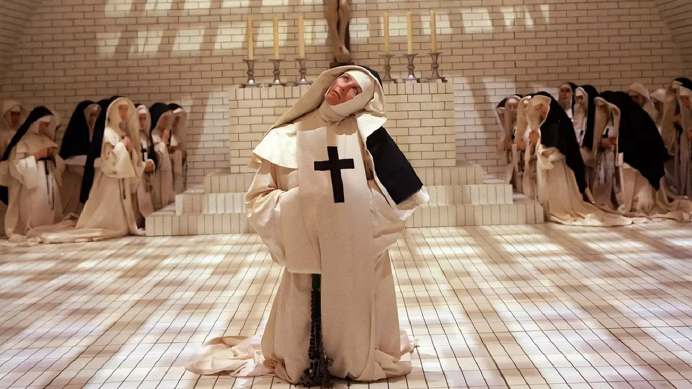
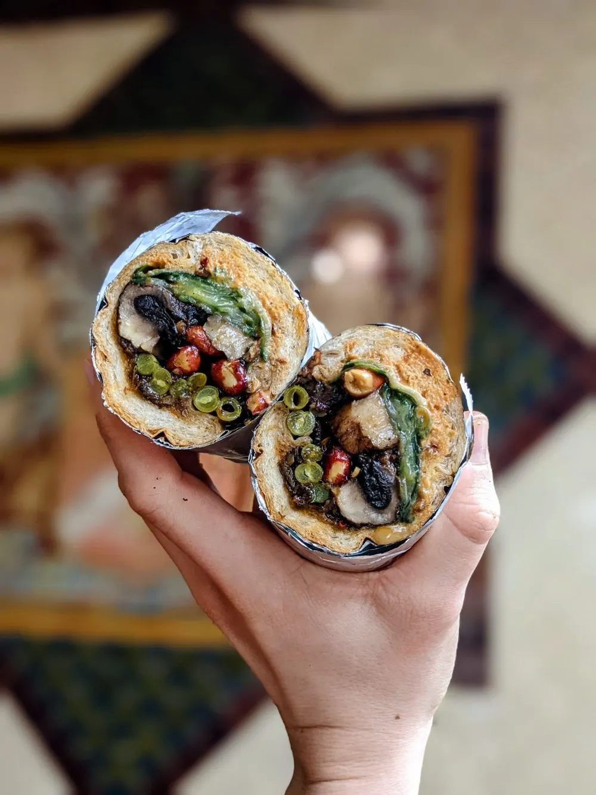

*it's black friday, so the best deal on offer is a £5 gig in brixton and the dignity you save by not queuing.*

# the tip

## london, friday 27–sunday 29 november 2026

it's black friday, advent starts on sunday, and the sun gives up at about four, so everything is begging for your card details. ignore the bollocks. the london museum opens its new home in smithfield, a brewery pub opens in walthamstow, and peckham potters, dalston artists, and a finnish church are all selling things you might actually want. there's a £5 gig, a cinema rave, and some ken russell blasphemy. keep your wallet shut, you absolute lightweight.

## some events for doing

### 1. london museum, smithfield

the london museum opens in smithfield's old general market on saturday, with three free galleries, the lord mayor's state coach, and underground spaces where you can watch trains pass. enormous, free, and guaranteed to be heaving.

[grab a free ticket before the rest of london does](https://www.londonmuseum.org.uk/smithfield/)

**when:** opens saturday 28 november at 10am. visitor guides list friday and saturday hours as 10am–11pm and sunday hours as 10am–6pm, so sunday 29 november runs 10am–6pm. the museum's own page publishes no hours · **venue:** london museum smithfield, general market, west smithfield, ec1a 9ag, closest to farringdon and barbican stations · **cost:** free, with an optional donation when you book. some exhibitions and events carry their own charges · **booking:** free timed tickets are online for 28 november to 31 december. walk-ups are welcome but the museum strongly recommends booking in the opening weeks. last ticketed entry on saturdays is 7.15pm, with walk-ins until 9.30pm if there's space.

### 2. e8 art and craft trail, dalston

about 30 artists and makers open their homes and studios across dalston, showing ceramics, illustration, jewellery, and fine art. free, nosy, and the only legal way to poke about in a stranger's spare room.

[snoop round a stranger's spare room, legally](https://www.e8artandcrafttrail.co.uk/)

**when:** saturday 28 november and sunday 29 november, 11am–5pm. the prince george's group show on parkholme road is listed as open on sunday only · **venue:** over 20 addresses around dalston, e8, including a new space at 195 mare street and galleries at the prokofiev studio on ramsgate street · **cost:** free. the site doesn't state a price, and the free entry comes from ianvisits · **booking:** none mentioned, so walk up. the site has an interactive map for planning a route.

### 3. the kiln rooms christmas sale, peckham

up to 100 local makers fill two peckham studios with handmade ceramics, and there's mulled wine to help you justify a fourth mug. opening night is friday, entry is free, and it beats another shitty candle.

[buy a mug before your aunt buys another candle](https://www.thekilnrooms.com/open-studios)

**when:** friday 27 november, 5–9pm, then saturday 28 november and sunday 29 november, 11am–5pm · **venue:** the kiln rooms' bellenden road studio and copeland park studio, peckham, se15. the page links to maps but gives no street addresses · **cost:** free entry. ceramics are priced by the makers · **booking:** none mentioned, so walk up.

### 4. the ugly one, dalston

marius von mayenburg's dark comedy follows a man told that everyone thinks he's ugly, who has an operation and becomes beautiful. four actors play eight characters in an hour. sharp, rude, and four stars from the guardian.

[book it, because latecomers get shut out](https://www.arcolatheatre.com/event/the-ugly-one/)

**when:** friday 27 november, 6.30pm, and saturday 28 november, 3pm and 6.30pm. no sunday performance is listed. it runs about 60 minutes with no latecomers or readmittance · **venue:** arcola theatre, studio 2, 24 ashwin street, dalston, e8 3dl · **cost:** £20 to £29, with concessions available · **booking:** online through the arcola. ages 16+, with warnings for sexual innuendo and brief depictions of sex. the page shows a sold-out banner but lists book now or last few against these dates, so check before you set off.

### 5. the devils, dalston

ken russell's 1971 film about demonic possession in a 17th-century french convent returns in a new 4k restoration, with oliver reed and vanessa redgrave. saturday has sold out, so sunday afternoon is your sin slot. notorious, restored, and certificate 18 for a reason.

[book a pew for some sunday blasphemy](https://riocinema.org.uk/Rio.dll/WhatsOn?f=3060730)

**when:** sunday 29 november, 2.20pm, running 103 minutes. the saturday 4.30pm show is sold out, and another screening is listed for wednesday 2 december · **venue:** rio cinema, 107 kingsland high street, dalston, e8 2pb · **cost:** the page doesn't list a price, so check at checkout · **booking:** online through the rio's listing. certificate 18, and the sunday show carries no sold-out marker.

## some noise after dark

### 6. lewis x lewis, dalston

klara lewis and her dad graham, of wire, share a cafe oto stage, with a short set each. klara plays with nik colk void and graham with margaret fiedler mcginnis and kenichi iwasa. family bonding, minus the turkey.

[book a ticket for the loudest family reunion in dalston](https://www.cafeoto.co.uk/events/lewis-x-lewis/)

**when:** friday 27 november, 7.30pm. the page doesn't list doors · **venue:** cafe oto, 18–22 ashwin street, dalston, e8 3dl · **cost:** £19 standard, £17 in advance, and £12 for members · **booking:** online through cafe oto's event page. the page shows no sold-out marker and states no age limit.

### 7. mark kavuma quintet, dalston

trumpeter mark kavuma debuts a new quintet with new compositions and a new musical direction, on his own label, banger factory records. expect melody and improvisation across two sets. tight, warm, and a proper saturday night.

[book a seat and let the trumpet do the talking](https://www.vortexjazz.co.uk/event/mark-kavuma-quintet-2/)

**when:** saturday 28 november. doors 7.45pm and music 8.30pm, in two sets · **venue:** vortex jazz club, 11 gillett square, dalston, n16 8az · **cost:** £17.50 standard, £15 for vortex members, and £12.50 for students and uc beneficiaries · **booking:** online through universe. the page shows no sold-out marker.

### 8. nudey, fool, alien chicks, and pedro pedro pedro, brixton

a fiver buys four bands on saturday, including new york electronic indie act nudey launching their album *upon the once and future* in the uk, plus fool, alien chicks, and pedro pedro pedro. midnight karaoke follows. cheap, loud, and likely to end in shit singing.

[spend a fiver and sing something you'll regret at midnight](https://www.windmillbrixton.co.uk/events/2026-11-28-nudey-fool-alien-chicks-pedro-pedro-pedro-the-windmill)

**when:** saturday 28 november, 8pm, with midnight karaoke. the page doesn't list doors · **venue:** the windmill, 22 blenheim gardens, brixton, sw2 5bz · **cost:** £5 e-ticket, with a service charge added at checkout · **booking:** online through the windmill's event page. ages 18+, and the page shows no sold-out marker.

### 9. something wicked this way comes, dalston

the rio turns its horror season into a rave from 11.30pm, with live acts from dark folk to trip-hop-infused black metal, then djs playing jungle, gabber, grime, and dubstep. daft, dark, and absolutely not for your nan.

[book a ticket and let the monsters out to play](https://riocinema.org.uk/Rio.dll/WhatsOn?f=2861239)

**when:** saturday 28 november, 11.30pm. the listed runtime is 210 minutes, which suggests a finish around 3am, but the page doesn't state an end time · **venue:** rio cinema, 107 kingsland high street, dalston, e8 2pb · **cost:** the page doesn't list a price, so check at checkout · **booking:** online through the rio's listing. ages 18+. no line-up is named, and the page shows no sold-out marker.

## stuff to eat and drink

### 10. black horse tap, walthamstow

east london brewing co opens a pub above its walthamstow brewery on friday, with 80 seats inside, 80 on the terrace, and a fire-cooked menu from play with fire. a new boozer on a beer mile is a public service.

[raise a first pint in a brand new boozer](https://www.instagram.com/blackhorsetap_/)

**when:** opens friday 27 november. hot dinners lists it as open thursday to sunday, with djs at weekends, but no hours are published in the sources we checked · **venue:** the black horse tap, unit 2–4 lockwood way, blackhorse road, walthamstow, e17 5rb · **cost:** no prices are published. the menu includes brisket sausage rolls, basque-style black pudding, and slow-smoked alabama chicken · **booking:** none is mentioned, so assume you'll walk up. check instagram for hours.

### 11. finnish church christmas fair, rotherhithe

the finnish church in rotherhithe sells hot glögi, with or without a shot, plus salmon soup, bbq sausages, cinnamon buns, and moomin memorabilia. live christmas music is planned. cosy, odd, and a decent excuse to day-drink before dark.

[drink glögi like a sensible nordic person](https://britannia.merimieskirkko.fi/en/tapahtuma/joulumyyjaiset-2025/)

**when:** friday 27 november, 12–8pm, and saturday 28 november and sunday 29 november, 12–6pm. it runs again the following weekend · **venue:** finnish church in london, 33 albion street, rotherhithe, se16 7hz · **cost:** the church's page doesn't state entry or drink prices, and ianvisits lists the fair as free · **booking:** none for walking in. the pre-order deadline for baked goods has passed.

### 12. mondo sando at grove house tavern, camberwell

mondo sando, a south east london sub outfit, serves from the grove house tavern in camberwell, with an ever-changing menu of bold fillings. the kitchen stays open until 9pm on saturday. messy, bold, and best eaten with both hands.

[book a table and get both hands dirty](https://www.grovehousetavern.co.uk/food/)

**when:** friday 27 november, lunch 12–3pm and dinner 6–9pm. saturday 28 november, 1–9pm. sunday 29 november, 1–5pm. the page doesn't mention these dates specifically · **venue:** grove house tavern, 26 camberwell grove, camberwell, se5 8re · **cost:** the page doesn't list prices · **booking:** the page has a book now button. the menu changes with seasonality and availability.

---

## minted to skinted

### two ways to spend the weekend

black friday wants your money, but london doesn't have to. here are two versions of friday to sunday, one for the recently paid and one for everyone counting coins.

### minted-ish: a family gig, a play, a trumpeter, and a carol concert

friday is lewis x lewis at cafe oto, £19 standard or £17 in advance. saturday afternoon is *the ugly one* at the arcola, from £20, and saturday night is mark kavuma at the vortex for £17.50. sunday ends with the windmill's christmas carol concert at 7.30pm for £6, with stephen evens and his band, holy springs, the doldrums, and the gathering doubt.

that comes to £60.50 if you book cafe oto in advance, before any booking fees and the windmill's service charge. you get a father-and-daughter noise set, a play about faces, a jazz quintet, and an early christmas singalong, which is a better return than any sale.

### skinted: pots, art, a museum, and a fiver gig

friday starts at the finnish church fair in rotherhithe, free until 8pm according to ianvisits, then the kiln rooms' opening night in peckham, free until 9pm. if you'd rather have noise, tate modern's free session with nkisi and mhamad safa runs 7–9.30pm, but advance tickets have gone, so it's walk-up on capacity.

saturday is the e8 trail from 11am, the london museum until 11pm, and the windmill at 8pm for your fiver. sunday is the e8 trail again until 5pm, then the finnish fair until 6pm.

that's £5 in advertised admission, plus a service charge at checkout. you'll still need to eat and drink, and the black horse tap publishes no prices, so budget for that yourself.

**the verdict:** the free weekend has a museum, two craft sales, and a trail through strangers' spare rooms. the expensive one has a play, a trumpeter, and a family jam. both end with you on a night bus, smelling faintly of mulled wine.

## dating 101

### advent weekend: how to pick a date without buying a mug

black friday is the one weekend of the year when everybody is already feeling the strain. here are five rules for dating through it, with venues.

1. **pick somewhere with an exit.** the london museum is free, open until 11pm on saturday, and big enough to lose a dud in the roman bit. nobody needs a two-hour contract on a first date.
2. **don't book a convent possession for date one.** *the devils* is a certificate 18 film about a 17th-century priest accused of witchcraft, and it runs 103 minutes. save it for the date where you already know whether they scream.
3. **use *the ugly one* as a compatibility test.** it's 60 minutes, ages 16+, and warns of sexual innuendo and brief depictions of sex. if they laugh at the right bits, keep them. be on time, because latecomers aren't admitted.
4. **don't buy them a mug on date one.** the kiln rooms sale is lovely, but a handmade mug says you've mentally cleared a shelf for them. wait until you've survived a breakfast together.
5. **choose a pub nobody can call theirs.** the black horse tap opens on friday, so neither of you has an ex, a regular table, or a history there. keep it that way for at least three pints.

if it goes badly, blame black friday. everyone else does.

## saturday, in order

### a timetable for people with legs and ambition

saturday has a trail, a play, a brand new museum, a jazz quintet, and a cinema rave, mostly in dalston and the city. you can do the lot if you eat lunch like an adult.

1. **11am: e8 art and craft trail, dalston.** it's open until 5pm. pick any address on the map and work outward.
2. **3pm: *the ugly one* at the arcola.** it runs about 60 minutes and shuts out latecomers.
3. **4.30pm: the london museum, smithfield.** it's open until 11pm on saturdays, with last ticketed entry at 7.15pm. book a free timed slot, because opening day will be rammed.
4. **7.45pm doors, 8.30pm music: mark kavuma at the vortex.** it's two sets, so leave smithfield in good time.
5. **11.30pm: something wicked this way comes at the rio.** the finish isn't listed, so don't plan anything early on sunday, including *the devils* at 2.20pm.
6. **south of the river?** swap steps 1 to 3 for the kiln rooms in peckham from 11am, the finnish church fair in rotherhithe from noon, and mondo sando in camberwell from 1pm. then catch the windmill in brixton at 8pm for your fiver.

pick two or three. any more and you're a tourist in your own city.

---

**before you put your shoes on:** listings and prices were checked on 25 november. the london museum's own page publishes no opening hours, so the saturday and sunday times come from visitor guides. the e8 trail's site doesn't state a price, and the free entry comes from ianvisits. the arcola's page shows a sold-out banner next to book now and last few markers, so check for returns. the rio's pages don't list prices, and *the devils* is sold out on saturday. the black horse tap's instagram link comes from hot dinners and we couldn't open it, and the pub's hours aren't published. the finnish church's page doesn't state entry or drink prices, and the kiln rooms' page gives no street addresses. tate modern's friday session with nkisi and mhamad safa is sold out in advance, with walk-ups subject to capacity. don't mistake a book now button for a seat.
